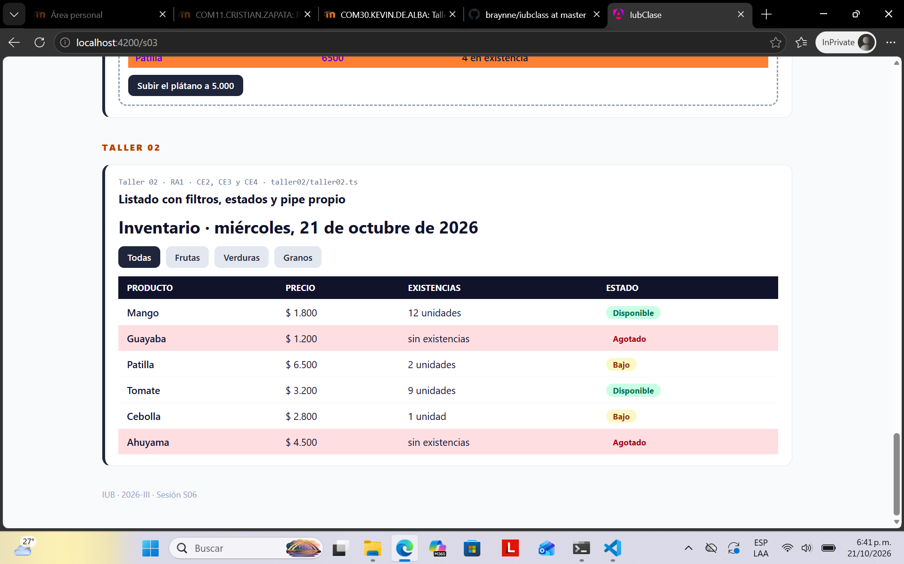
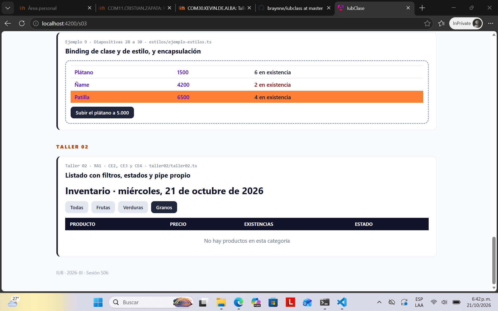

# COM30 · PROGRAMACIÓN CON FRAMEWORKS PARA WEB · 2026-III

## Taller 02 · *Listado con filtros, estados y pipe propio*

RA1 · Corte 1 · Sesión S03 · Docente: Kevin Erney De Alba Pomárico

| Modalidad | Calificación | Criterios | Cierre |
| --- | --- | --- | --- |
| **Individual** | **Escala 1.0 – 5.0** | **RA1 · CE2 · CE3 · CE4** | **Mié 30 sep · 16:59** |

| NOMBRE Y APELLIDOS: | CÓDIGO: | FECHA: |
| --- | --- | --- |
| Braynne Romero Balza | 1043666564 | 21 de octubre de 2026 |

---

## Propósito y condiciones

El taller integra los tres bloques de la sesión S03: control de flujo (`@if`, `@for` con `@empty`, `@switch`), pipes integrados y propios, y estilos de componente. Evalúa los criterios **CE2, CE3 y CE4 del RA1**.

| # | Condición |
| --- | --- |
| **1** | Se trabaja sobre el fork del repositorio de la clase (github.com/kevindealbap10/iubclass). Con Angular CLI, el componente va en `src/app/`; en StackBlitz, todo el código va en `src/main.ts`. El orden de trabajo está en `GUIA_TALLER_02.md`, en el mismo repositorio. |
| **2** | Se usan exactamente los datos de la tabla 1. Una solución que compila pero no reproduce los resultados de la tabla 2 no cumple el requisito. |
| **3** | Este documento se diligencia con el enlace del fork y las dos capturas, y se entrega en PDF. |

---

## Requerimiento *(los pesos suman 5.0)*

Se requiere una vista de inventario que permita filtrar los productos por categoría y que muestre para cada uno su precio, sus existencias y su estado.

| Req. | Criterio de aceptación | Peso |
| --- | --- | --- |
| **R1** | Tabla de productos construida con `@for` y `track` sobre un campo propio del producto. Bloque `@empty` con el mensaje «No hay productos en esta categoría». | 0.8 |
| **R2** | Cuatro botones de filtro: Todas, Frutas, Verduras, Granos. La categoría seleccionada se guarda en una `signal`; la lista visible se calcula en un `computed`. | 1.0 |
| **R3** | Columna Estado mostrada con `@switch`: agotado (cantidad 0), bajo (1 o 2), disponible (3 o más). El estado se calcula en un `computed`, no en un método de la plantilla. | 0.8 |
| **R4** | Precio con el pipe `currency` en formato es-CO, sin decimales. Fecha del día en el título con el pipe `date` y formato `fullDate`. | 0.6 |
| **R5** | Pipe propio `unidades` para la columna Existencias: 0 → «sin existencias», 1 → «1 unidad», n → «n unidades». | 1.0 |
| **R6** | La fila de un producto agotado se resalta con `[class.agotado]`, definida en los estilos del componente. | 0.4 |

### Tabla 1 · Datos de prueba

| Producto | Categoría | Precio | Cantidad |
| --- | --- | --- | --- |
| **Mango** | Frutas | 1.800 | 12 |
| **Guayaba** | Frutas | 1.200 | 0 |
| **Patilla** | Frutas | 6.500 | 2 |
| **Tomate** | Verduras | 3.200 | 9 |
| **Cebolla** | Verduras | 2.800 | 1 |
| **Ahuyama** | Verduras | 4.500 | 0 |

### Tabla 2 · Resultados esperados

| Verificación | Resultado |
| --- | --- |
| **Filtros Todas / Frutas / Verduras** | 6 / 3 / 3 filas |
| **Filtro Granos** | Encabezado de la tabla y mensaje de `@empty`; ninguna fila de producto |
| **Estado agotado** | Guayaba y Ahuyama, con la fila resaltada |
| **Estado bajo** | Patilla y Cebolla |
| **Estado disponible** | Mango y Tomate |
| **Columna Existencias** | Mango: 12 unidades · Cebolla: 1 unidad · Guayaba: sin existencias |
| **Precio del mango** | $ 1.800 |

> **Cada condición se verifica en sus dos ramas.** El filtro Granos es el único caso que ejerce `@empty`, y los productos con 0, 1, 2 y 12 unidades ejercen todas las ramas de R3 y R5. Un filtro que nunca se ha visto devolver cero elementos no está verificado.

---

## Estructura inicial

`src/main.ts` en StackBlitz · en Angular CLI se reparte entre `main.ts` y `app.ts`

**Punto de partida del componente**

```typescript
import { Component, computed, signal, LOCALE_ID } from '@angular/core';
import { bootstrapApplication } from '@angular/platform-browser';
import { CurrencyPipe, DatePipe, registerLocaleData } from '@angular/common';
import localeEsCo from '@angular/common/locales/es-CO';

interface Producto { nombre: string; categoria: string; precio: number; cantidad: number; }

// 1. defina aquí UnidadesPipe (R5)

@Component({
  selector: 'app-root',
  imports: [CurrencyPipe, DatePipe],          // 2. agregue UnidadesPipe
  template: `
    <h1>Inventario · {{ hoy | date:'fullDate' }}</h1>
    <!-- 3. un botón por categoría que ejecute filtro.set(...) -->
    <table>
      <!-- 4. encabezado: Producto, Precio, Existencias, Estado -->
      <tbody><!-- 5. @for sobre filas() con track, @switch y @empty --></tbody>
    </table>
  `,
  styles: [`/* 6. estilo de la clase agotado */`]
})
export class App {
  hoy = new Date();
  filtro = signal('Todas');
  productos = signal<Producto[]>([
    { nombre: 'Mango', categoria: 'Frutas', precio: 1800, cantidad: 12 },
    // completar con los cinco productos restantes de la tabla 1
  ]);
  visibles = computed(() => this.productos());
  // 7. filtrar según filtro()
  // 8. computed filas: visibles() con el estado de cada producto
}

registerLocaleData(localeEsCo);
bootstrapApplication(App, { providers: [{ provide: LOCALE_ID, useValue: 'es-CO' }] });
```

---

## Evidencias *(se diligencian en este documento)*

**ENLACE DEL FORK** *(debe abrir en una ventana privada del navegador)*

https://github.com/braynne/iubclass/tree/master

**EVIDENCIA · INSERTE AQUÍ LA CAPTURA**
Captura 1 · Filtro Todas: las seis filas, con los estados, las existencias con el pipe `unidades`, los precios en formato es-CO y las filas agotadas resaltadas.



&nbsp;

**EVIDENCIA · INSERTE AQUÍ LA CAPTURA**
Captura 2 · Filtro Granos: el encabezado de la tabla y el mensaje del bloque `@empty`.



---

## Rúbrica de evaluación *(los pesos suman 5.0)*

| Criterio | Desempeño esperado | Peso |
| --- | --- | --- |
| **R1 · CE3** | `@for` con `track` sobre un campo propio y `@empty` con el mensaje indicado | 0.8 |
| **R2 · CE4** | Filtro en `signal` y lista visible en `computed`; los cuatro filtros reproducen la tabla 2 | 1.0 |
| **R3 · CE3** | Estado calculado en `computed` y mostrado con `@switch`; las tres ramas correctas | 0.8 |
| **R4 · CE2** | `currency` en es-CO sin decimales y `date` con `fullDate` | 0.6 |
| **R5 · CE4** | Pipe `unidades` importado en el componente; las tres salidas correctas | 1.0 |
| **R6 · CE3** | `[class.agotado]` con estilo declarado en el componente | 0.4 |
| **Entrega** | Puntualidad, enlace del fork accesible, capturas legibles, nombre de archivo correcto | 0.4 |
|  | **TOTAL** | **5.0** |

> **Descuento de 0.3 por ocurrencia** de cualquiera de estos defectos: `@for` sin `track` o con `track $index` sobre la lista filtrada; lectura de una signal sin paréntesis; modificación directa del estado (`push`, `sort` sin copia, `++`); filtrado implementado con un pipe en lugar de un `computed`.

---

## Entrega *(miércoles 30 de septiembre de 2026, 16:59 · actividad «Taller 02» del aula)*

1. Confirme que el componente y el pipe están en el fork, en `src/`.
2. Diligencie en este documento sus datos, el enlace del fork y las dos capturas.
3. Guárdelo como `COM30_Taller02_Apellido.pdf` y súbalo al aula. Un trabajo que no está en el aula se considera no entregado.
4. Las consultas se registran en el foro de la actividad, con el mensaje de error completo.

---

*Institución Universitaria de Barranquilla · COM30 Programación con Frameworks para Web · Sesión S03 · 2026-III*
