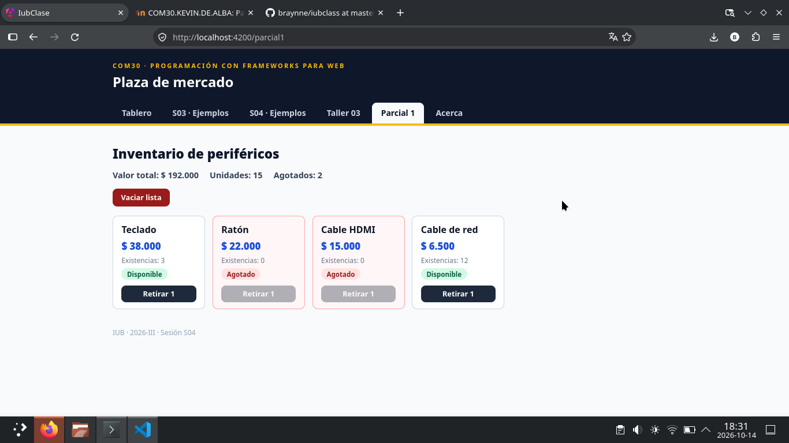
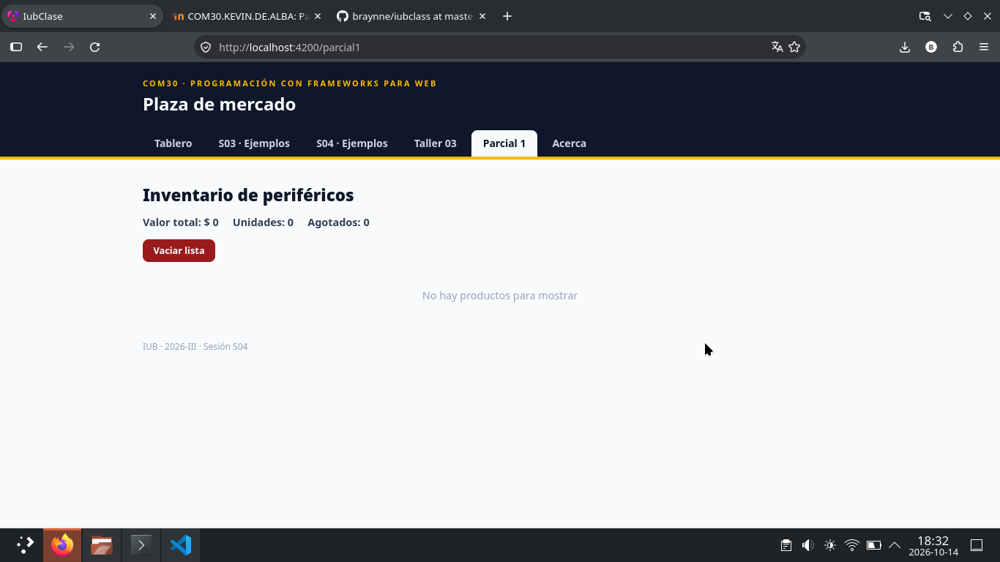

# COM30 · Programación con Frameworks para Web · 2026-III

## Parcial 1 · Práctico · *Inventario con componentes que se comunican*

RA1 · Corte 1 · Sesiones S01 a S04 · Docente: Kevin Erney De Alba Pomárico

| Modalidad | Calificación | Criterios | Duración |
| --- | --- | --- | --- |
| **Individual** | **Escala 1.0 – 5.0** | **RA1 · CE1 · CE2 · CE3 · CE4** | **75 minutos** |

**NOMBRE Y APELLIDOS:** Braynne Romero Balza

**CÓDIGO:** 1043666564

**FECHA:** 2026/10/14

---

## Condiciones

| # | Condición |
| --- | --- |
| 1 | Entorno: VS Code con Node y Angular CLI, sobre su fork del repositorio de la clase, después de pulsar Sync fork. Los dos componentes van en `src/app/parcial1/`, un archivo por componente, con la ruta `/parcial1`. Se usa solo lo trabajado en las sesiones S01 a S04. Un equipo sin Node o sin CLI usa StackBlitz, con los componentes en `src/main.ts`. |
| 2 | Se usan exactamente los datos de la tabla 1. Una solución que compila pero no reproduce la tabla 2 no cumple el requisito. |
| 3 | El parcial pesa el 40 % del Corte 1. Este componente vale el 50 % del parcial; el otro 50 % es el cuestionario del aula. |
| 4 | Se entregan dos archivos: este documento diligenciado y el proyecto comprimido, sin `node_modules`. |

---

## Requerimiento

*Los pesos suman 5.0*

Se requiere una pantalla de inventario de periféricos con dos componentes. **Inventario** (padre) guarda la lista y calcula los totales; **FichaProducto** (hijo) muestra un producto y permite retirar una unidad.

| Req. | Criterio de aceptación | Peso |
| --- | --- | --- |
| **R1** | Diseño previo: la tabla del contrato (sección Evidencias) indica, para cada componente, sus inputs y outputs con tipo y dato emitido, y qué estado guarda el padre. Coincide con el código. [CE1] | 0.8 |
| **R2** | Inventario declara la lista en una `signal` y calcula en `computed` el valor total (precio × existencias), las unidades totales y la cantidad de productos agotados. Las signals se leen con paréntesis. [CE4] | 1.0 |
| **R3** | La plantilla de Inventario usa `@for` con `track` sobre un campo propio y `@empty` con el mensaje «No hay productos para mostrar». FichaProducto muestra el estado con `@switch` (Agotado, Inventario bajo, Disponible). Los precios y el valor total usan el pipe `currency` en `es-CO` sin decimales, con la configuración regional registrada en `main.ts`. [CE3] | 1.2 |
| **R4** | FichaProducto recibe el producto con `input.required()` y avisa con `output()` llamado `retirar`, que emite el nombre. El botón «Retirar 1» queda deshabilitado con 0 existencias. Inventario es el único que modifica la lista, con `update()` y objetos nuevos. [CE2] | 1.2 |
| **R5** | Análisis de un fallo y su corrección, redactados en la sección R5 de Evidencias. [CE2] | 0.8 |

> **Regla del estado.** Agotado con 0 existencias; Inventario bajo con menos de 3; Disponible con 3 o más. El estado se calcula en un `computed`, no en un método llamado desde la plantilla.

### Tabla 1 · Datos de prueba

| Producto | Precio | Existencias | Estado inicial |
| --- | --- | --- | --- |
| **Teclado** | $ 38.000 | 6 | Disponible |
| **Ratón** | $ 22.000 | 0 | Agotado |
| **Cable HDMI** | $ 15.000 | 2 | Inventario bajo |
| **Cable de red** | $ 6.500 | 12 | Disponible |

### Tabla 2 · Secuencia de prueba

*Cada paso parte del estado del anterior, sin recargar la página.*

| Paso | Acción | Valor total | Unidades | Agotados | Qué se observa |
| --- | --- | --- | --- | --- | --- |
| **P1** | Estado inicial | $ 336.000 | 20 | 1 | Ratón: Agotado, botón deshabilitado · Cable HDMI: Inventario bajo |
| **P2** | Retirar Cable HDMI dos veces | $ 306.000 | 18 | 2 | Cable HDMI: Agotado, botón deshabilitado |
| **P3** | Retirar Teclado tres veces | $ 192.000 | 15 | 2 | Caso límite: Teclado con 3 unidades sigue en Disponible |
| **P4** | Retirar Teclado una vez más | $ 154.000 | 14 | 2 | Teclado con 2 unidades cambia a Inventario bajo |
| **P5** | Pulsar «Vaciar lista» | $ 0 | 0 | 0 | Mensaje de `@empty`; valor 0 y unidades 0 |

> **El paso P3 es el caso límite:** Teclado queda con 3 unidades y su estado sigue en Disponible. Una condición escrita con `<=` en lugar de `<` falla solo en este paso.

---

## Estructura esperada y pasos

`src/app/parcial1/` · solo la estructura, sin el desarrollo

**Archivos y esqueleto**

```ts
// ficha-producto.ts
export interface Producto { nombre: string; precio: number; existencias: number; }

@Component({ selector: 'app-ficha', imports: [CurrencyPipe], template: `...` })
export class FichaProducto {
  // input obligatorio · computed del estado · output retirar
}

// inventario.ts
@Component({ selector: 'app-inventario', imports: [FichaProducto, CurrencyPipe], template: `...` })
export class Inventario {
  // signal de la lista · computed de los tres totales · retirar() · vaciar()
}

// app.routes.ts: { path: "parcial1", component: Inventario }
// main.ts del fork: registerLocaleData(localeEsCo) y LOCALE_ID es-CO, como en la S03
```

| Paso | Qué hacer | Qué debe observarse |
| --- | --- | --- |
| **1** | Pulse Sync fork, ejecute `git pull` y `npx ng serve`. Si el equipo no reconoce `node`, abra `entorno-sala.cmd`. | La aplicación del fork abre en `localhost:4200` sin errores en la terminal. |
| **2** | Cree los dos archivos con sus componentes vacíos y la ruta `/parcial1`. | `/parcial1` carga una página en blanco; la terminal no muestra errores. |
| **3** | Diligencie la tabla del contrato (R1) antes de escribir lógica. | Cada input y output del contrato tiene nombre, tipo y dato emitido. |
| **4** | En Inventario, declare la lista con los datos de la tabla 1 y los tres totales. Muéstrelos como texto simple. | Los valores coinciden con la fila P1 de la tabla 2. |
| **5** | En FichaProducto, reciba el producto y muestre su estado. En Inventario, repita las fichas y cubra la lista vacía. | Cada producto muestra el estado de la tabla 1. |
| **6** | Comunique el aviso del hijo al padre y actualice la lista sin mutarla. | Los pasos P2, P3 y P4 reproducen la tabla 2, incluido el límite de P3. |
| **7** | Agregue el botón de vaciar y el formato de moneda. | P5 muestra el mensaje de lista vacía; los precios aparecen en es-CO. |
| **8** | Tome las capturas, resuelva R5, ejecute `npx ng build` y `git push`. Comprima el proyecto sin `node_modules`. | El build termina sin errores y el fork muestra el último commit. |

---

## Evidencias

*Se diligencian en este documento*

**Enlace del fork (debe abrir en una ventana privada del navegador):**

https://github.com/braynne/iubclass/tree/master

### Tabla del contrato (R1)

| Componente | Inputs (nombre y tipo) | Outputs (nombre y dato) | Estado propio |
| --- | --- | --- | --- |
| **FichaProducto** | `producto: Producto` (`input.required()`, obligatorio): `{ nombre: string; precio: number; existencias: number }` | `retirar: string` (`output()`): emite el **nombre** del producto que se quiere retirar | Ninguno. Solo deriva `estado` de su input con un `computed`. No guarda ni modifica datos. |
| **Inventario** | — | — | `productos = signal<Producto[]>`: la lista completa de la tabla 1. Es el único dueño y solo él la modifica con `update()` y objetos nuevos. |

### Captura 1



Captura 1 · Paso P3: valor total $ 192.000 y Teclado en estado Disponible.

### Captura 2



Captura 2 · Paso P5: mensaje de `@empty`, valor total $ 0 y 0 unidades.

### R5 · Análisis de un fallo

El siguiente hijo compila y no muestra error. Con la lista de la tabla 1, el usuario pulsa tres veces «Retirar 1» en Teclado.

**Hijo con defecto**

```ts
export class FichaMala {
  producto = input.required<Producto>();
  retirar() { this.producto().existencias -= 1; }
}
```

**5.1 · ¿Qué valor muestra Inventario como valor total tras las tres pulsaciones y por qué?**

Inventario sigue mostrando **$ 336.000**, el total inicial: no cambia.

El hijo muta la propiedad de un objeto (`this.producto().existencias -= 1`) que ya estaba dentro de la signal `productos` del padre. La signal guarda una **referencia**; al modificar un campo del objeto no se le asigna un valor nuevo, así que la signal no notifica ningún cambio. El `computed` `valorTotal` está memorizado y solo se recalcula cuando cambia una signal de la que depende; como ninguna cambió, devuelve el valor cacheado. En pantalla la existencia del Teclado baja a 3 (la interpolación del hijo se relee al ser un evento), pero el total del padre se queda en $ 336.000. Es peligroso porque compila y no muestra ningún error; solo se corrige si el padre reemplaza la lista con `update()` y objetos nuevos.

**5.2 · Corrija el hijo y escriba el método del padre que recibe el aviso**

Hijo corregido: ya no modifica el input; solo emite el nombre.

```ts
export class FichaBuena {
  producto = input.required<Producto>();
  retirar = output<string>();
}
```

Y en la plantilla del padre: `(retirar)="retirar($event)"`.

Método del padre que recibe el aviso, con `update()` y un objeto nuevo por producto (sin `-=` ni mutar):

```ts
retirar(nombre: string) {
  this.productos.update((lista) =>
    lista.map((p) =>
      p.nombre === nombre && p.existencias > 0
        ? { ...p, existencias: p.existencias - 1 }
        : p,
    ),
  );
}
```

---

## Rúbrica de evaluación

*Los pesos suman 5.0*

| Criterio | Desempeño esperado | Peso |
| --- | --- | --- |
| **R1 · CE1** | Contrato completo, con tipos y dato emitido; coherente con el código; estado solo en el padre | 0.8 |
| **R2 · CE4** | Signal con la tabla 1; tres `computed` correctos en P1 a P5; lectura con paréntesis | 1.0 |
| **R3 · CE3** | `@for` con `track` y `@empty`; `@switch` con las tres ramas, incluido el límite de P3; `currency` es-CO | 1.2 |
| **R4 · CE2** | `input.required` y `output` retirar; botón deshabilitado en P1 y P2; `update()` sin mutar; P1 a P5 correctos | 1.2 |
| **R5 · CE2** | 5.1 identifica que el total no cambia y por qué (0.4); 5.2 corrige con `output` y `update()` (0.4) | 0.8 |
|  | **TOTAL** | **5.0** |

> **Descuento de 0.3 por ocurrencia** de: un hijo que modifica un input o el estado del padre; la lista declarada en un hijo; mutación con `push`, `splice`, `++` o `-=`; `@for` sin `track`; signal leída sin paréntesis.

---

## Entrega

**Miércoles 14 de octubre de 2026, 19:30** · actividad «Parcial 1 · Práctico» del aula

1. Confirme que los componentes están en el fork (`git push`) y que `npx ng build` termina sin errores.
2. Diligencie sus datos, el enlace del fork, el contrato, las dos capturas y la sección R5.
3. Guarde este documento como `COM30_Parcial1_Apellido.docx`, comprima el proyecto sin la carpeta `node_modules` como `COM30_Parcial1_Apellido.zip` y suba los dos archivos al aula. Un trabajo que no está en el aula se considera no entregado.
4. Durante el parcial no se consultan otros estudiantes; las dudas sobre el enunciado se plantean al docente.

---

*Institución Universitaria de Barranquilla · COM30 Programación con Frameworks para Web · Parcial 1 · 2026-III*
